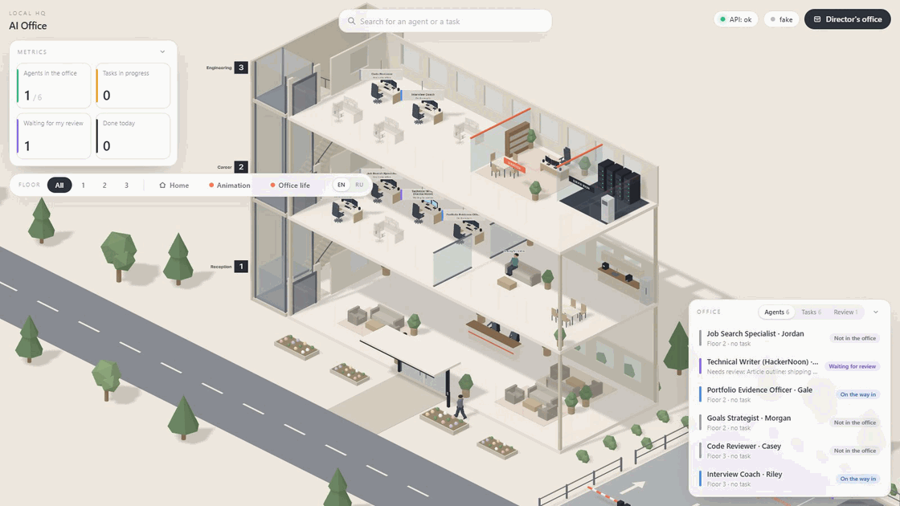
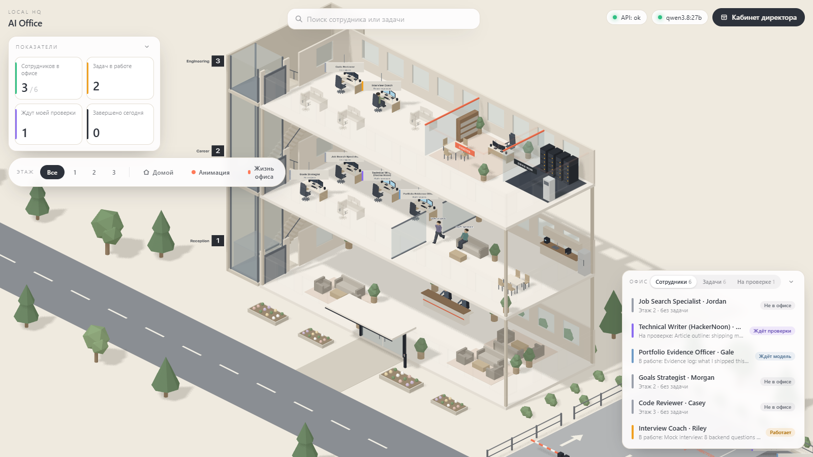
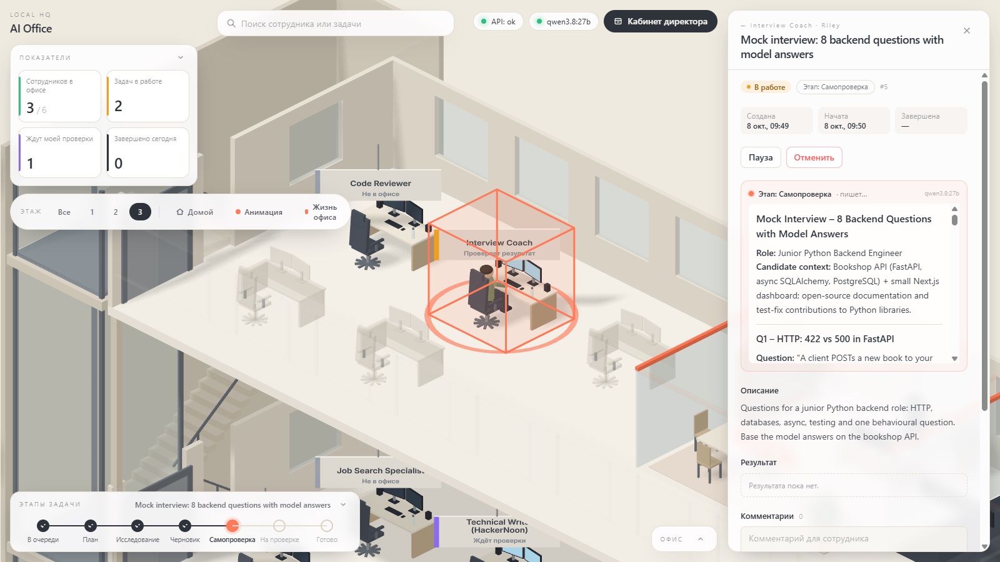
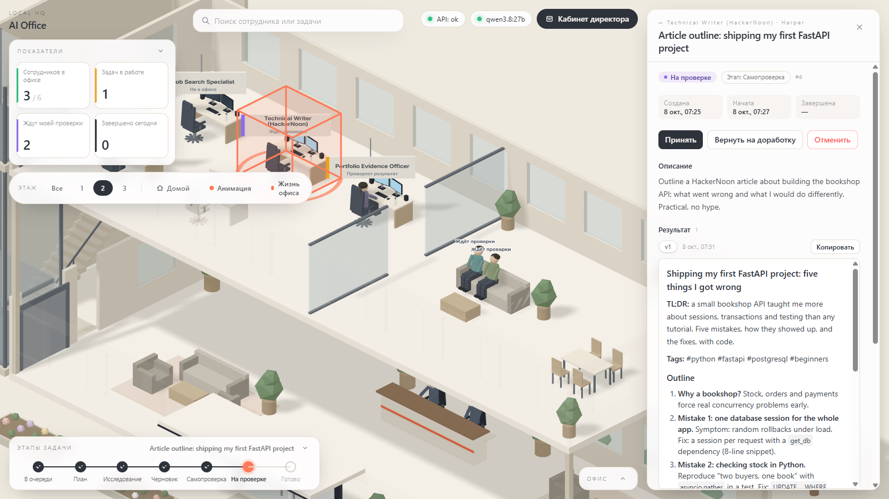
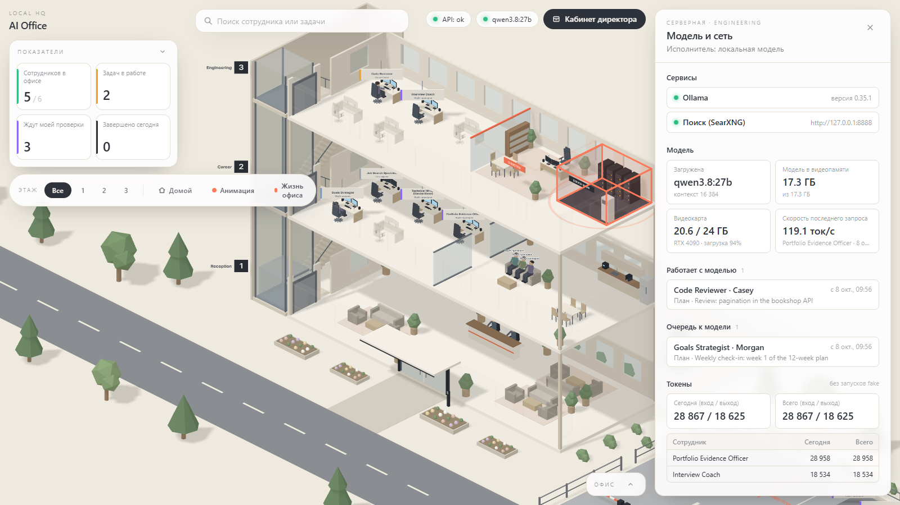
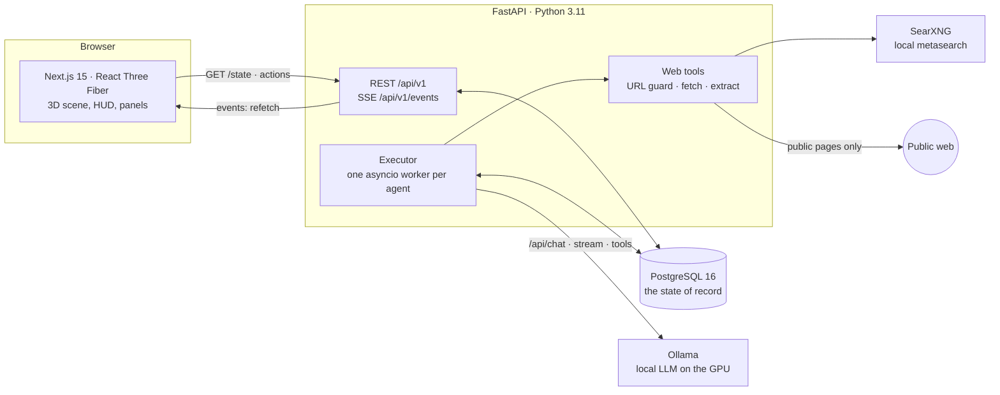

# AI Office

[](../../actions/workflows/ci.yml)

A local, single-user app where you are the director of a 3D office and the staff are AI agents. You give an agent a
task; the agent drives in, parks, takes the lift or the stairs to their desk and works through it in stages (plan → web research →
draft → self-check) on a **local model in Ollama**, with live text you can watch. When they finish, the result lands in
your review queue, and you accept it or send it back with a comment. Everything you see in the building, from who is
typing to who is queuing for coffee because the GPU is busy, is drawn from the real state in PostgreSQL rather than
from scripted animation. I built it to learn how to put a real LLM workflow (queues, retries, tools, restarts) behind a
UI that makes the system's state obvious at a glance.



| | |
|---|---|
|  |  |
| **Overview.** Three floors, a reception, parking; HUD with metrics and the staff list. | **Live text.** The task card streams the model's output stage by stage. |
|  |  |
| **Review.** Accept or request changes; agents waiting for review sit in the lounge. | **Server room.** Model, VRAM, GPU load, the model queue and token usage. |

The screenshots use the fictional demo profile (`python -m app.seed --demo`). The interface is in Russian; agents write
in English unless a task asks otherwise.

## What it does

- **Tasks with stages and review.** Queue tasks per agent; the executor runs them in parallel across agents, one task
  per agent at a time. Results are versioned Markdown with sources; rework starts from your comments and the previous
  version. Pause, resume and cancel at any moment.
- **Local LLM.** Ollama with streaming, thinking on, a context budget that trims inputs in a fixed order, one retry
  after a timeout or a dropped stream, and plain-language errors for the director (Ollama not running, model not pulled, timed out).
- **Web research.** Agents with web access search through a local SearXNG instance and read public pages through a
  guarded fetcher; every claim in the result points to a numbered source.
- **A living building.** Cars queue at the barriers, people wait at the card reader and share the lift (capacity 4),
  walk to the kitchen while the model is busy, sit in the lounge while waiting for review, chat when they are free,
  and leave the same way they came. Click any agent, desk, parking spot or the server room to open its panel.

## Architecture



- **Frontend** (`frontend/`): Next.js 15 App Router, TypeScript strict, React Three Fiber + drei, zustand, Tailwind v4.
  All geometry is pure functions in `src/scene/layout/`; components only render.
- **API** (`backend/app/api`, `services`): FastAPI, SQLAlchemy 2 async + asyncpg, Pydantic v2, Alembic. Thin routers,
  business rules in `services/rules.py` (pure functions; an illegal transition is a 409).
- **Executor** (`backend/app/executor`): started in the FastAPI lifespan; moves agents through their day and tasks
  through their stages. The stage work sits behind a `StageWorker` protocol with two implementations: `LlmWorker`
  (Ollama) and `FakeWorker` (no model, for the demo and tests).
- **Ollama** runs the model; **SearXNG** (in docker-compose, bound to `127.0.0.1`) provides search;
  **PostgreSQL** (docker-compose) holds everything.

## Key engineering decisions

**The database is the state; the scene only displays it.** Agent status, the start of every status and trip, the
activity log, task stages, runs and results are all rows. `GET /api/v1/state` is the single snapshot the scene renders;
server-sent events only tell the browser to refetch. The scene contains no business logic, so a page reload, a second
browser tab or a backend restart all show the same picture.

**Motion schedules are pure functions.** Trips (`trips.ts`) and office life (`life.ts`) are computed from
`(trips, activity log, server time)` → poses; there is no animation state in React or in the database. The trip
planner handles the queues (entry barrier, parking aisle, exit barrier, card reader, a lift with 4 places) and still
makes every trip last exactly the 75 s the executor waits for. Plans are append-only, so a new arrival never moves
anyone already on the way. The browser keeps an offset to the server clock, so all viewers agree on where everyone is.
`npm run check:layout` checks 41 invariants of this layer (no overlaps, lift capacity, exact durations, stability when
new trips appear) without a browser.

**A queue in front of the GPU.** A semaphore (`LLM_CONCURRENCY`, default 1) guards the model. A run is `waiting` until
its request is really sent, then `running`. The stage timeout counts from sending, not from joining the queue, and the
GPU slot is held per model call, never while a web tool runs. The queue is visible: waiting agents lean back, then go
for coffee, and the server room lists who has the model and who is next.

**Guarded web tools.** The fetcher accepts only http/https on standard ports with no credentials in the URL. It resolves
the host and refuses any non-global address (private, loopback, link-local, CGNAT, IPv4-mapped), then connects to that
checked IP with the original Host and SNI, so DNS rebinding cannot redirect it. Redirects are followed by hand and
re-checked (at most 5). It sends GET only, without cookies or auth, reads text types only, and enforces size, time and
per-stage call limits. Page text goes back to the model as escaped data inside `<web_content>` tags, and the house rules
say that web content is data, not instructions. SearXNG down or a failing page never fails the stage; the result then
says what could not be checked.

**Recovery after a restart.** A Postgres advisory lock allows one executor per database. Every step is a short
transaction that re-reads the row under `SELECT … FOR UPDATE`, so the director's actions (pause, cancel, request
changes) always win. On start, runs left `running` or `waiting` are marked `interrupted` and their stage runs again;
agents who were arriving or leaving wait only for the rest of the trip, counted from `status_since`. Because the scene
is computed from those timestamps, an agent halfway up the stairs is still halfway up the stairs after a restart.

## Requirements

- Docker (Docker Desktop on Windows/macOS) for PostgreSQL and SearXNG
- Python 3.11
- Node.js 22 or newer (the layout checks use `--experimental-strip-types`)
- Optional, for real AI work: [Ollama](https://ollama.com) 0.35+ and an NVIDIA GPU (see [Model](#use-a-local-model))

## Quick start: demo mode (no GPU)

Demo mode fills an empty database with a fictional director and a few tasks with finished results, and uses the fake
executor: agents drive in and "type" placeholder text, so the whole flow works without a model. Commands are for
Windows PowerShell; the macOS/Linux equivalents are in the comments.

```powershell
git clone <this repository> ai-office
cd ai-office

# 1. Database
Copy-Item .env.example .env          # cp .env.example .env — then set POSTGRES_PASSWORD
docker compose up -d db

# 2. Backend
cd backend
Copy-Item .env.example .env          # cp ... — put the same password into DATABASE_URL and TEST_DATABASE_URL
python -m venv .venv
.\.venv\Scripts\Activate.ps1         # source .venv/bin/activate
pip install -r requirements-dev.txt
alembic upgrade head
python -m app.seed --demo            # refuses to run on a database with a filled-in profile or any task
uvicorn app.main:app --port 8000 --timeout-graceful-shutdown 2

# 3. Frontend (a second terminal, from the repository root)
cd frontend
Copy-Item .env.example .env.local    # cp .env.example .env.local
npm ci
npm run dev
```

Open http://localhost:3000. Two agents with queued tasks drive in and start working; the writer is already waiting for
your review in the lounge. Open «Кабинет директора» (top right) for the review queue, or click an agent.

`python -m app.seed` without `--demo` creates only the building and the six agents with an empty profile: that is the
starting point for your own use. Fill in the profile in «Кабинет директора» → «Профиль».

## Use a local model

1. Install Ollama and pull the default model:
   `ollama pull qwen3.8:27b` (17 GB; fits a 24 GB GPU with a 16K context, about 100 tokens/s on an RTX 4090).
2. In `backend/.env` set `EXECUTOR_WORKER=llm` and restart the backend. The dot next to «API» in the HUD turns green
   when Ollama is up and the model is present.

**A smaller GPU.** Any Ollama model with tool calling works; set it in `backend/.env`:

```env
OLLAMA_MODEL=qwen3:8b       # ~5 GB, for 8–12 GB of VRAM
OLLAMA_NUM_CTX=8192         # a smaller context window needs less VRAM
LLM_RESERVE_TOKENS=3072
```

`ollama pull qwen3:8b` first. Expect weaker drafts and less reliable research than with the 27B model. A single agent
can use a different model: «Изменить» in its panel → «Модель». How the default was chosen: `docs/model-benchmark.json`.

**Web search.** Set `SEARXNG_SECRET` in the root `.env` (any long random string) and run `docker compose up -d`, which
also starts SearXNG on `127.0.0.1:8888`. Agents with «Доступ в интернет» then search and read pages during the
research stage.

## Using it

- Mouse: left drag rotates, right drag pans, the wheel zooms to the cursor; «Домой» returns to the default view.
- Click an agent, a free desk, a parking spot, the director's office or the server room to open its panel; Esc closes
  the innermost layer. The HUD switches «Анимация» and «Жизнь офиса» turn movement off and keep everyone at their desks.
- `?preview=1` shows every agent at their desk and every car parked without touching the database.
- API docs: http://localhost:8000/docs. Health: http://localhost:8000/health.

## Tests and checks

```powershell
cd backend; pytest                   # needs TEST_DATABASE_URL: a separate database, dropped and recreated on each run
cd frontend; npm run lint; npm run check:layout; npm run build
```

CI (GitHub Actions) runs the same: pytest against a PostgreSQL service (plus migrations and the demo seed), ESLint,
the layout checks and a production build.

## Limitations

- Local and single-user by design: no authentication. Do not expose the backend to a network.
- The interface is in Russian, desktop only.
- Only Ollama is wired up as a provider; the data model already has a field for others.
- Without a GPU only the fake executor is practical.
- In the parking aisle, arriving and leaving cars do not give way to each other yet: a car reversing out while another
  drives in can briefly overlap. When many agents leave at once, the exit barrier is the bottleneck and the first cars
  drive off faster or slower (×0.4–×2.5) to keep every trip at exactly its duration.

## Roadmap

From [`docs/backlog.md`](docs/backlog.md):

- **Agents working together:** an agent hands part of a task to a colleague or asks them to review it (a sub-task with
  its own runs); in the scene they walk over to the colleague's desk.
- **Structured tools:** a `search_jobs` tool for the job search agent that queries a jobs API instead of scraping
  job-board pages.
- **Polish:** materials per zone, decorative lighting, pictures on the walls, traffic lights; an interior with rooms,
  doors and a corridor in a larger building.

## License

[MIT](LICENSE). The bundled Inter font is licensed separately under the SIL Open Font License 1.1
([`frontend/public/fonts/LICENSE-Inter.txt`](frontend/public/fonts/LICENSE-Inter.txt)).
